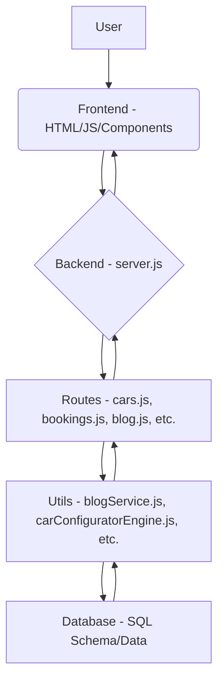

# VIVA Preparation: CarHub360 Project Overview

This document provides a comprehensive overview of the CarHub360 project, designed to help you prepare for your viva. It covers the project's purpose, architecture, core functionalities, database schema, frontend-backend interaction, key technologies, design patterns, and potential discussion points for challenges and future improvements.

## 1. Project Purpose and Architecture

The primary goal of this project is to provide a comprehensive platform for managing and showcasing cars, facilitating customer interactions (e.g., booking, contact), and potentially offering administrative tools for content management (e.g., blog, car inventory).

The project follows a client-server architecture, likely a variation of a Model-View-Controller (MVC) or a more component-based approach for the frontend.

*   **Frontend (Client-side):**
    *   Composed of multiple HTML pages (e.g., [`index.html`](index.html), [`about.html`](about.html), [`car-details.html`](car-details.html), [`blog.html`](blog.html), [`admin.html`](admin.html)).
    *   Each HTML page is associated with a corresponding JavaScript file (e.g., [`app.js`](app.js), [`about-app.js`](about-app.js), [`car-details-app.js`](car-details-app.js), [`blog-app.js`](blog-app.js), [`admin-app.js`](admin-app.js)) that handles the page's dynamic behavior, data fetching, and user interactions.
    *   A `components/` directory suggests a modular frontend, where reusable UI components (e.g., [`Header.js`](components/Header.js), [`Footer.js`](components/Footer.js), [`CarCard.js`](components/CarCard.js), [`SearchBar.js`](components/SearchBar.js)) are defined and integrated into different pages.
    *   The `assets/` directory contains static resources like car images.

*   **Backend (Server-side):**
    *   A central [`server.js`](server.js) file likely acts as the entry point for the backend, handling HTTP requests, routing, and interacting with the database.
    *   The `routes/` directory contains separate JavaScript files for different API endpoints (e.g., [`routes/cars.js`](routes/cars.js), [`routes/bookings.js`](routes/bookings.js), [`routes/blog.js`](routes/blog.js), [`routes/users.js`](routes/users.js), [`routes/messages.js`](routes/messages.js), [`routes/admin.js`](routes/admin.js), [`routes/reviews.js`](routes/reviews.js), [`routes/services.js`](routes/services.js)). This promotes a clean separation of concerns for API logic.
    *   The `utils/` directory likely contains utility functions and services (e.g., [`utils/blogService.js`](utils/blogService.js), [`utils/carConfiguratorEngine.js`](utils/carConfiguratorEngine.js)) that encapsulate business logic and interact with the database or external services.
    *   The `database/` directory contains SQL scripts for database schema definition and data manipulation (e.g., [`database/schema.sql`](database/schema.sql), [`database/sample_data.sql`](database/sample_data.sql)). This indicates a relational database is being used.

### Data Flow (High-Level):

1.  A user interacts with the frontend (e.g., navigates to a page, clicks a button).
2.  The frontend JavaScript (e.g., [`app.js`](app.js), component scripts) makes an asynchronous request (e.g., using `fetch` or `XMLHttpRequest`) to a backend API endpoint.
3.  The backend [`server.js`](server.js) receives the request and routes it to the appropriate handler in the `routes/` directory.
4.  The route handler uses utility functions from `utils/` to perform business logic and interact with the database.
5.  The database (defined by `database/` scripts) stores and retrieves data.
6.  The backend sends a response (e.g., JSON data) back to the frontend.
7.  The frontend JavaScript updates the UI based on the received data.



## 2. Core Functionalities and Implementation

Here's an explanation of the core functionalities of the project and how they are likely implemented:

1.  **Car Listing and Browsing:**
    *   **Purpose:** Allows users to view a catalog of available cars, often with search and filtering capabilities.
    *   **Frontend Implementation:**
        *   [`index.html`](index.html) and [`search-results.html`](search-results.html) would serve as the main pages for displaying cars.
        *   [`components/SearchBar.js`](components/SearchBar.js) would handle user input for searching.
        *   [`components/CarGrid.js`](components/CarGrid.js) would be responsible for rendering a collection of [`components/CarCard.js`](components/CarCard.js) components, each representing a single car with basic information (image, name, price).
        *   JavaScript files like [`app.js`](app.js) or [`search-results-app.js`](search-results-app.js) would fetch car data from the backend and pass it to these components for rendering.
    *   **Backend Implementation:**
        *   [`routes/cars.js`](routes/cars.js) would expose API endpoints (e.g., `/api/cars`, `/api/cars/search`) to retrieve car data from the database.
        *   It would handle query parameters for searching, filtering, and pagination.

2.  **Car Details View:**
    *   **Purpose:** Provides comprehensive information about a specific car, including images, specifications, features, and pricing.
    *   **Frontend Implementation:**
        *   [`car-details.html`](car-details.html) would be the dedicated page for a single car.
        *   [`car-details-app.js`](car-details-app.js) would fetch the specific car's data based on an ID from the URL.
        *   Components like [`components/CarDetailsView.js`](components/CarDetailsView.js), [`components/CarImageGallery.js`](components/CarImageGallery.js), [`components/CarSpecifications.js`](components/CarSpecifications.js), [`components/CarFeatures.js`](components/CarFeatures.js), and [`components/CarPricing.js`](components/CarPricing.js) would display the various aspects of the car.
    *   **Backend Implementation:**
        *   [`routes/cars.js`](routes/cars.js) would have an endpoint (e.g., `/api/cars/:id`) to fetch detailed information for a single car based on its unique identifier.

3.  **Car Booking:**
    *   **Purpose:** Allows users to select a car, specify booking dates, and submit a booking request.
    *   **Frontend Implementation:**
        *   [`booking.html`](booking.html) would host the booking interface.
        *   [`booking-app.js`](booking-app.js) would manage the state of the booking form.
        *   [`components/CarBookingForm.js`](components/CarBookingForm.js) would provide input fields for dates, user details, and a submission button. It would likely validate user input before sending it to the backend.
    *   **Backend Implementation:**
        *   [`routes/bookings.js`](routes/bookings.js) would handle POST requests for new bookings.
        *   It would validate booking details, check car availability, and store the booking information in the database.

4.  **Car Configurator:**
    *   **Purpose:** Enables users to customize certain aspects of a car (e.g., color, trim, optional features) and see the impact on price or appearance.
    *   **Frontend Implementation:**
        *   [`configurator.html`](configurator.html) would be the configurator interface.
        *   [`configurator-app.js`](configurator-app.js) would orchestrate the configurator logic.
        *   [`components/CarConfigurator.js`](components/CarConfigurator.js) would be the main component, integrating sub-components like [`components/ColorPicker.js`](components/ColorPicker.js) for color selection and potentially [`components/Viewport3D.js`](components/Viewport3D.js) for a visual representation of the configured car.
    *   **Backend Implementation:**
        *   [`utils/carConfiguratorEngine.js`](utils/carConfiguratorEngine.js) would contain the business logic for applying configuration options, calculating prices, and potentially generating a unique configuration ID.
        *   There might be a dedicated route in [`routes/cars.js`](routes/cars.js) or a separate configurator route to handle configuration requests and return updated car details or pricing.

5.  **Blog Management (View, Create, Admin):**
    *   **Purpose:** Provides a platform for publishing articles, allowing users to read them, and administrators to create and manage them.
    *   **Frontend Implementation:**
        *   **Viewing:** [`blog.html`](blog.html) for the blog feed, [`blog-post.html`](blog-post.html) for individual posts. [`blog-app.js`](blog-app.js) and [`blog-post-app.js`](blog-post-app.js) would fetch and display blog data. [`components/BlogFeed.js`](components/BlogFeed.js) would list [`components/BlogPostCard.js`](components/BlogPostCard.js) components, and [`components/BlogPostView.js`](components/BlogPostView.js) would display a full post.
        *   **Creating/Editing:** [`blog-create.html`](blog-create.html) for creating new posts. [`blog-create-app.js`](blog-create-app.js) would handle the form submission. [`components/BlogEditor.js`](components/BlogEditor.js) would provide the rich text editing interface.
        *   **Admin:** [`blog-admin.html`](blog-admin.html) for managing posts. [`blog-admin-app.js`](blog-admin-app.js) would interact with the admin API. [`components/BlogAdminPanel.js`](components/BlogAdminPanel.js) would display a list of posts with options to edit or delete.
    *   **Backend Implementation:**
        *   [`routes/blog.js`](routes/blog.js) would handle API requests for fetching blog posts (all, by ID), creating new posts, updating existing posts, and deleting posts.
        *   [`utils/blogService.js`](utils/blogService.js) would encapsulate the logic for interacting with the database for blog-related operations.

6.  **User Authentication and Authorization:**
    *   **Purpose:** Secure access to certain parts of the application (e.g., admin dashboard, user profiles) by verifying user identity.
    *   **Frontend Implementation:**
        *   [`login.html`](login.html) would present the login form.
        *   [`login-app.js`](login-app.js) would handle form submission, send credentials to the backend, and store authentication tokens (e.g., JWT) in local storage upon successful login.
    *   **Backend Implementation:**
        *   [`routes/users.js`](routes/users.js) would contain endpoints for user registration and login.
        *   It would hash passwords, compare them during login, and generate authentication tokens. Middleware would be used to protect authenticated routes.

7.  **Admin Dashboard:**
    *   **Purpose:** Provides administrators with an overview of the system, metrics, and tools to manage content, users, bookings, and messages.
    *   **Frontend Implementation:**
        *   [`admin.html`](admin.html) and [`dashboard.html`](dashboard.html) would be the entry points for the admin interface.
        *   [`admin-app.js`](admin-app.js) and [`dashboard-app.js`](dashboard-app.js) would fetch data relevant to the dashboard.
        *   Components like [`components/AdminDashboard.js`](components/AdminDashboard.js), [`components/DashboardMetrics.js`](components/DashboardMetrics.js), and [`components/AdminMessages.js`](components/AdminMessages.js) would display key information and provide management interfaces.
    *   **Backend Implementation:**
        *   [`routes/admin.js`](routes/admin.js) would provide endpoints for admin-specific operations and data retrieval.
        *   Other routes like [`routes/messages.js`](routes/messages.js) and [`routes/bookings.js`](routes/bookings.js) would likely have endpoints accessible only to authenticated administrators for managing messages and bookings.

8.  **Contact and Messaging:**
    *   **Purpose:** Allows users (guests or logged-in) to send messages or inquiries to the administrators.
    *   **Frontend Implementation:**
        *   [`contact.html`](contact.html) and [`guest-contact.html`](guest-contact.html) would host the contact forms.
        *   [`contact-app.js`](contact-app.js) and [`guest-contact-app.js`](guest-contact-app.js) would handle form submission.
        *   [`components/ContactContent.js`](components/ContactContent.js) and [`components/GuestContactForm.js`](components/GuestContactForm.js) would provide the form elements.
    *   **Backend Implementation:**
        *   [`routes/messages.js`](routes/messages.js) would handle POST requests for new messages, storing them in the database.
        *   The database schema files [`database/contact_schema.sql`](database/contact_schema.sql) and [`database/create_messages_table.sql`](database/create_messages_table.sql) define the structure for storing these messages.

9.  **Locations/Hubs:**
    *   **Purpose:** Displays various car pickup/drop-off locations, potentially with an interactive map.
    *   **Frontend Implementation:**
        *   [`locations.html`](locations.html) would be the page for displaying locations.
        *   [`locations-app.js`](locations-app.js) would fetch location data.
        *   [`components/HubLocationsView.js`](components/HubLocationsView.js) would be the main component, integrating [`components/LocationsList.js`](components/LocationsList.js) to show a list of locations and [`components/InteractiveMap.js`](components/InteractiveMap.js) to visualize them.
    *   **Backend Implementation:**
        *   There might be a dedicated route (e.g., `routes/locations.js` if it existed) or endpoints within [`routes/services.js`](routes/services.js) to provide location data.

## 3. Database Schema and its Role

The database schema for this project is well-structured and normalized, designed to support the various functionalities of the car dealership/rental application. It's built using MySQL.

### Part 1: User Management System (from [`database/schema.sql`](database/schema.sql))

1.  **`user_roles`**:
    *   **Role:** Defines different roles within the system (e.g., admin, customer, dealer) and their associated permissions. This allows for role-based access control.
    *   **Key Fields:** `id`, `role_name`, `permissions` (JSON for flexible permission management).
    *   **Normalization:** 1NF.

2.  **`users`**:
    *   **Role:** Stores detailed information about all users of the system. It's a central table linked to many other tables.
    *   **Key Fields:** `id`, `username`, `email`, `password` (hashed), `first_name`, `last_name`, `phone`, `role_id` (foreign key to `user_roles`), various address and contact details, `account_status`.
    *   **Normalization:** 2NF, with `role_id` linking to `user_roles`.
    *   **Relationships:**
        *   One-to-Many with `user_roles` (a role can have many users).
        *   Self-referencing Many-to-One with `referred_by` (a user can be referred by another user).

3.  **`user_preferences`**:
    *   **Role:** Stores individual user settings and preferences, allowing for a personalized experience.
    *   **Key Fields:** `id`, `user_id` (foreign key to `users`), `preference_key`, `preference_value`.
    *   **Normalization:** 3NF, ensuring that preferences are directly related to the user and not dependent on other non-key attributes.
    *   **Relationships:** One-to-Many with `users` (a user can have many preferences).

### Part 1.5: Contact/Messaging System (from [`database/contact_schema.sql`](database/contact_schema.sql) and [`database/create_messages_table.sql`](database/create_messages.sql))

*Note: The presence of both `contact_inquiries`/`contact_responses` and `messages` tables suggests a potential evolution or dual messaging system. `contact_schema.sql` explicitly states it "replaces/updates the previous messaging system with contact inquiries and responses."*

1.  **`contact_categories`**:
    *   **Role:** Categorizes incoming contact inquiries (e.g., "General Inquiry," "Car Rental," "Technical Issue"). This helps in routing and prioritizing inquiries.
    *   **Key Fields:** `id`, `name`, `description`, `department`, `priority_level`.
    *   **Normalization:** 1NF.

2.  **`contact_inquiries`**:
    *   **Role:** Stores details of all contact inquiries submitted by users or guests.
    *   **Key Fields:** `id`, `inquiry_id` (unique reference), `category_id` (foreign key to `contact_categories`), `user_id` (optional foreign key to `users`), `name`, `email`, `subject`, `message`, `status`, `assigned_to` (foreign key to `users` for admin assignment).
    *   **Normalization:** 2NF.
    *   **Relationships:**
        *   Many-to-One with `contact_categories`.
        *   Many-to-One with `users` (for the user who made the inquiry and the admin it's assigned to).

3.  **`contact_responses`**:
    *   **Role:** Stores responses to specific contact inquiries, allowing for a conversation thread.
    *   **Key Fields:** `id`, `inquiry_id` (foreign key to `contact_inquiries`), `responder_id` (foreign key to `users`), `content`, `is_read`.
    *   **Normalization:** 3NF.
    *   **Relationships:** Many-to-One with `contact_inquiries`.

4.  **`conversations`** (implied by `create_messages_table.sql` but not explicitly defined in the provided schemas):
    *   **Role:** Would typically represent a distinct conversation thread between users.
    *   **Key Fields:** `id`, `subject`, `created_at`, etc.
    *   **Relationships:** One-to-Many with `messages`.

5.  **`messages`** (from [`database/create_messages_table.sql`](database/create_messages_table.sql)):
    *   **Role:** Stores individual messages within a conversation. This seems to be part of an older or parallel messaging system, as `contact_schema.sql` aims to replace it.
    *   **Key Fields:** `id`, `conversation_id` (foreign key to `conversations`), `sender_id` (foreign key to `users`), `content`.
    *   **Normalization:** 3NF.
    *   **Relationships:** Many-to-One with `conversations` and `users`.

### Part 2: Vehicle Management System (from [`database/schema_part2.sql`](database/schema_part2.sql))

1.  **`car_brands`**:
    *   **Role:** Stores information about car manufacturers.
    *   **Key Fields:** `id`, `name`, `logo_url`, `country`.
    *   **Normalization:** 1NF.

2.  **`car_categories`**:
    *   **Role:** Defines different types of car categories (e.g., "SUV," "Sedan," "Electric").
    *   **Key Fields:** `id`, `name`, `description`.
    *   **Normalization:** 1NF.

3.  **`car_models`**:
    *   **Role:** Stores information about specific car models (e.g., "Toyota Camry," "Tesla Model 3").
    *   **Key Fields:** `id`, `brand_id` (foreign key to `car_brands`), `model_name`, `category_id` (foreign key to `car_categories`).
    *   **Normalization:** 2NF.
    *   **Relationships:** Many-to-One with `car_brands` and `car_categories`.

4.  **`features_master`**:
    *   **Role:** A master list of all possible car features (e.g., "ABS," "Airbags," "Bluetooth").
    *   **Key Fields:** `id`, `name`, `category` (e.g., 'safety', 'comfort').
    *   **Normalization:** 1NF.

5.  **`cars`**:
    *   **Role:** The central inventory table for individual cars available for rental or sale. This is a highly detailed table.
    *   **Key Fields:** `id`, `sku` (unique identifier), `model_id` (foreign key to `car_models`), `variant_name`, `year`, `fuel_type`, `transmission`, engine details, dimensions, `rental_price_daily`, `selling_price`, `availability_status`, `owner_id` (foreign key to `users`), `dealer_id` (foreign key to `users`).
    *   **Normalization:** 3NF, with foreign keys linking to `car_models` and `users`.
    *   **Relationships:**
        *   Many-to-One with `car_models`.
        *   Many-to-One with `users` (for owner and dealer).

### Part 3: Booking & Service Systems (from [`database/schema_part3.sql`](database/schema_part3.sql))

1.  **`car_features`**:
    *   **Role:** A junction table to link cars with their specific features from `features_master`. This allows a many-to-many relationship between cars and features.
    *   **Key Fields:** `car_id` (foreign key to `cars`), `feature_id` (foreign key to `features_master`).
    *   **Normalization:** 3NF (as a junction table).
    *   **Relationships:** Many-to-Many between `cars` and `features_master`.

2.  **`car_images`**:
    *   **Role:** Stores URLs and metadata for images associated with each car.
    *   **Key Fields:** `id`, `car_id` (foreign key to `cars`), `image_url`, `image_type`, `is_primary`.
    *   **Normalization:** 3NF.
    *   **Relationships:** One-to-Many with `cars` (a car can have many images).

3.  **`payment_methods`**:
    *   **Role:** Lists available payment methods (e.g., "Credit Card," "Mobile Banking").
    *   **Key Fields:** `id`, `method_name`, `provider`.
    *   **Normalization:** 1NF.

4.  **`bookings`**:
    *   **Role:** Records all car rental, purchase, or test drive bookings.
    *   **Key Fields:** `id`, `booking_reference`, `user_id` (foreign key to `users`), `car_id` (foreign key to `cars`), `booking_type`, `rental_start_date`, `rental_end_date`, `total_amount`, `payment_status`, `booking_status`, `payment_method_id` (foreign key to `payment_methods`).
    *   **Normalization:** 3NF.
    *   **Relationships:**
        *   Many-to-One with `users`.
        *   Many-to-One with `cars`.
        *   Many-to-One with `payment_methods`.

5.  **`service_categories`**:
    *   **Role:** Categorizes different types of services offered (e.g., "Maintenance," "Repair," "Detailing").
    *   **Key Fields:** `id`, `name`, `description`.
    *   **Normalization:** 1NF.

6.  **`services`**:
    *   **Role:** Details specific services offered by the platform.
    *   **Key Fields:** `id`, `category_id` (foreign key to `service_categories`), `service_name`, `description`, `base_price`, `duration_minutes`.
    *   **Normalization:** 2NF.
    *   **Relationships:** Many-to-One with `service_categories`.

### Overall Role of the Database Schema:

The database schema is the backbone of the application, providing:

*   **Data Storage:** A persistent and organized way to store all application data.
*   **Data Integrity:** Through primary keys, foreign keys, and constraints, it ensures data consistency and prevents invalid data entries.
*   **Relationships:** Defines how different pieces of information are related, enabling complex queries and data retrieval.
*   **Scalability:** A normalized schema generally performs better and is easier to maintain and extend as the application grows.
*   **Foundation for Business Logic:** The structure of the database directly influences how the backend logic (e.g., in `routes/` and `utils/`) is implemented to interact with and manipulate data.

## 4. SQL Queries Used Throughout the Site

While direct SQL queries are typically abstracted within the backend's service layer (e.g., in `utils/` files) or directly within route handlers, we can infer the types of SQL operations performed based on the application's functionalities and database schema. The backend interacts with the MySQL database using a Node.js database driver (e.g., `mysql2` or `mysql` npm package) to execute these queries.

Here are the common types of SQL queries used:

### 1. SELECT Queries (Data Retrieval)

These are used extensively to fetch data for displaying on the frontend.

*   **Fetching all cars for listing:**
    ```sql
    SELECT c.*, cb.name AS brand_name, cc.name AS category_name
    FROM cars c
    JOIN car_models cm ON c.model_id = cm.id
    JOIN car_brands cb ON cm.brand_id = cb.id
    JOIN car_categories cc ON cm.category_id = cc.id
    WHERE c.listing_status = 'active';
    ```
*   **Fetching a single car's details:**
    ```sql
    SELECT c.*, cm.model_name, cb.name AS brand_name, cc.name AS category_name,
           GROUP_CONCAT(fm.name SEPARATOR ', ') AS features
    FROM cars c
    JOIN car_models cm ON c.model_id = cm.id
    JOIN car_brands cb ON cm.brand_id = cb.id
    JOIN car_categories cc ON cm.category_id = cc.id
    LEFT JOIN car_features cf ON c.id = cf.car_id
    LEFT JOIN features_master fm ON cf.feature_id = fm.id
    WHERE c.id = ?
    GROUP BY c.id;
    ```
*   **Fetching user details for authentication/profile:**
    ```sql
    SELECT u.id, u.username, u.email, u.password, ur.role_name
    FROM users u
    JOIN user_roles ur ON u.role_id = ur.id
    WHERE u.email = ?;
    ```
*   **Fetching blog posts:**
    ```sql
    SELECT bp.*, u.first_name, u.last_name
    FROM blog_posts bp
    JOIN users u ON bp.author_id = u.id
    WHERE bp.status = 'published'
    ORDER BY bp.created_at DESC;
    ```
*   **Fetching contact inquiries for admin dashboard:**
    ```sql
    SELECT ci.*, cc.name AS category_name, u.username AS assigned_admin
    FROM contact_inquiries ci
    JOIN contact_categories cc ON ci.category_id = cc.id
    LEFT JOIN users u ON ci.assigned_to = u.id
    WHERE ci.status = 'new' OR ci.status = 'in_progress';
    ```

### 2. INSERT Queries (Data Creation)

Used when new data needs to be added to the database, such as new bookings, user registrations, or blog posts.

*   **Creating a new user:**
    ```sql
    INSERT INTO users (username, email, password, first_name, last_name, role_id)
    VALUES (?, ?, ?, ?, ?, ?);
    ```
*   **Creating a new car booking:**
    ```sql
    INSERT INTO bookings (booking_reference, user_id, car_id, booking_type, rental_start_date, rental_end_date, total_amount, payment_status, booking_status)
    VALUES (?, ?, ?, ?, ?, ?, ?, ?, ?);
    ```
*   **Submitting a contact inquiry:**
    ```sql
    INSERT INTO contact_inquiries (inquiry_id, category_id, user_id, name, email, subject, message, priority, status, source)
    VALUES (?, ?, ?, ?, ?, ?, ?, ?, ?, ?);
    ```
*   **Creating a new blog post:**
    ```sql
    INSERT INTO blog_posts (author_id, title, content, status, published_at)
    VALUES (?, ?, ?, ?, ?);
    ```

### 3. UPDATE Queries (Data Modification)

Used to modify existing records in the database.

*   **Updating car availability status:**
    ```sql
    UPDATE cars
    SET availability_status = ?
    WHERE id = ?;
    ```
*   **Updating a user's profile information:**
    ```sql
    UPDATE users
    SET phone = ?, address_line1 = ?, city = ?
    WHERE id = ?;
    ```
*   **Updating a booking status:**
    ```sql
    UPDATE bookings
    SET booking_status = ?, payment_status = ?
    WHERE id = ?;
    ```
*   **Updating a blog post:**
    ```sql
    UPDATE blog_posts
    SET title = ?, content = ?, status = ?
    WHERE id = ?;
    ```
*   **Marking a contact inquiry as resolved:**
    ```sql
    UPDATE contact_inquiries
    SET status = 'resolved', assigned_to = ?
    WHERE id = ?;
    ```

### 4. DELETE Queries (Data Removal)

Used to remove records from the database, typically for administrative functions or when a user deletes their own content.

*   **Deleting a car entry (admin function):**
    ```sql
    DELETE FROM cars
    WHERE id = ?;
    ```
*   **Deleting a blog post:**
    ```sql
    DELETE FROM blog_posts
    WHERE id = ?;
    ```
*   **Deleting a contact inquiry:**
    ```sql
    DELETE FROM contact_inquiries
    WHERE id = ?;
    ```
## 4. SQL Queries Used Throughout the Site

While direct SQL queries are typically abstracted within the backend's service layer (e.g., in `utils/` files) or directly within route handlers, we can infer the types of SQL operations performed based on the application's functionalities and database schema. The backend interacts with the MySQL database using a Node.js database driver (e.g., `mysql2` or `mysql` npm package) to execute these queries.

Here are the common types of SQL queries used:

### 1. SELECT Queries (Data Retrieval)

These are used extensively to fetch data for displaying on the frontend.

*   **Fetching all cars for listing:**
    ```sql
    SELECT c.*, cb.name AS brand_name, cc.name AS category_name
    FROM cars c
    JOIN car_models cm ON c.model_id = cm.id
    JOIN car_brands cb ON cm.brand_id = cb.id
    JOIN car_categories cc ON cm.category_id = cc.id
    WHERE c.listing_status = 'active';
    ```
*   **Fetching a single car's details:**
    ```sql
    SELECT c.*, cm.model_name, cb.name AS brand_name, cc.name AS category_name,
           GROUP_CONCAT(fm.name SEPARATOR ', ') AS features
    FROM cars c
    JOIN car_models cm ON c.model_id = cm.id
    JOIN car_brands cb ON cm.brand_id = cb.id
    JOIN car_categories cc ON cm.category_id = cc.id
    LEFT JOIN car_features cf ON c.id = cf.car_id
    LEFT JOIN features_master fm ON cf.feature_id = fm.id
    WHERE c.id = ?
    GROUP BY c.id;
    ```
*   **Fetching user details for authentication/profile:**
    ```sql
    SELECT u.id, u.username, u.email, u.password, ur.role_name
    FROM users u
    JOIN user_roles ur ON u.role_id = ur.id
    WHERE u.email = ?;
    ```
*   **Fetching blog posts:**
    ```sql
    SELECT bp.*, u.first_name, u.last_name
    FROM blog_posts bp
    JOIN users u ON bp.author_id = u.id
    WHERE bp.status = 'published'
    ORDER BY bp.created_at DESC;
    ```
*   **Fetching contact inquiries for admin dashboard:**
    ```sql
    SELECT ci.*, cc.name AS category_name, u.username AS assigned_admin
    FROM contact_inquiries ci
    JOIN contact_categories cc ON ci.category_id = cc.id
    LEFT JOIN users u ON ci.assigned_to = u.id
    WHERE ci.status = 'new' OR ci.status = 'in_progress';
    ```

### 2. INSERT Queries (Data Creation)

Used when new data needs to be added to the database, such as new bookings, user registrations, or blog posts.

*   **Creating a new user:**
    ```sql
    INSERT INTO users (username, email, password, first_name, last_name, role_id)
    VALUES (?, ?, ?, ?, ?, ?);
    ```
*   **Creating a new car booking:**
    ```sql
    INSERT INTO bookings (booking_reference, user_id, car_id, booking_type, rental_start_date, rental_end_date, total_amount, payment_status, booking_status)
    VALUES (?, ?, ?, ?, ?, ?, ?, ?, ?);
    ```
*   **Submitting a contact inquiry:**
    ```sql
    INSERT INTO contact_inquiries (inquiry_id, category_id, user_id, name, email, subject, message, priority, status, source)
    VALUES (?, ?, ?, ?, ?, ?, ?, ?, ?, ?);
    ```
*   **Creating a new blog post:**
    ```sql
    INSERT INTO blog_posts (author_id, title, content, status, published_at)
    VALUES (?, ?, ?, ?, ?);
    ```

### 3. UPDATE Queries (Data Modification)

Used to modify existing records in the database.

*   **Updating car availability status:**
    ```sql
    UPDATE cars
    SET availability_status = ?
    WHERE id = ?;
    ```
*   **Updating a user's profile information:**
    ```sql
    UPDATE users
    SET phone = ?, address_line1 = ?, city = ?
    WHERE id = ?;
    ```
*   **Updating a booking status:**
    ```sql
    UPDATE bookings
    SET booking_status = ?, payment_status = ?
    WHERE id = ?;
    ```
*   **Updating a blog post:**
    ```sql
    UPDATE blog_posts
    SET title = ?, content = ?, status = ?
    WHERE id = ?;
    ```
*   **Marking a contact inquiry as resolved:**
    ```sql
    UPDATE contact_inquiries
    SET status = 'resolved', assigned_to = ?
    WHERE id = ?;
    ```

### 4. DELETE Queries (Data Removal)

Used to remove records from the database, typically for administrative functions or when a user deletes their own content.

*   **Deleting a car entry (admin function):**
    ```sql
    DELETE FROM cars
    WHERE id = ?;
    ```
*   **Deleting a blog post:**
    ```sql
    DELETE FROM blog_posts
    WHERE id = ?;
    ```
*   **Deleting a contact inquiry:**
    ```sql
    DELETE FROM contact_inquiries
    WHERE id = ?;
    ```
## 4. SQL Queries Used Throughout the Site
## 5. Entity-Relationship (ER) Diagram Overview

Below is a textual representation of the key entities (tables) and their relationships within the CarHub360 database. This helps visualize how different parts of the system are connected.

```
+-----------------+       +-----------------+       +-----------------+
|   user_roles    |       |      users      |       | user_preferences|
+-----------------+       +-----------------+       +-----------------+
| id (PK)         |------>| id (PK)         |<------| id (PK)         |
| role_name       |       | username        |       | user_id (FK)    |
| permissions     |       | email           |       | preference_key  |
+-----------------+       | password        |       | preference_value|
                          | first_name      |       +-----------------+
                          | last_name       |
                          | role_id (FK)    |
                          | referred_by (FK)|
                          +-----------------+
                                  |
                                  |
                                  V
+-----------------+       +-----------------+       +-----------------+
|contact_categories|------>|contact_inquiries|<------|contact_responses|
+-----------------+       +-----------------+       +-----------------+
| id (PK)         |       | id (PK)         |<------| id (PK)         |
| name            |       | inquiry_id      |       | inquiry_id (FK) |
| department      |       | category_id (FK)|       | responder_id (FK)|
+-----------------+       | user_id (FK)    |       | content         |
                          | email           |       +-----------------+
                          | subject         |
                          | message         |
                          | status          |
                          | assigned_to (FK)|
                          +-----------------+
                                  |
                                  |
                                  V
+-----------------+       +-----------------+       +-----------------+
|   car_brands    |       |   car_models    |       |       cars      |
+-----------------+       +-----------------+       +-----------------+
| id (PK)         |------>| id (PK)         |<------| id (PK)         |
| name            |       | brand_id (FK)   |       | sku             |
| logo_url        |       | model_id (FK)   |       | variant_name    |
+-----------------+       | category_id (FK)|       | year            |
                          +-----------------+       | fuel_type       |
                                  |                 | transmission    |
                                  |                 | rental_price_daily|
                                  V                 | selling_price   |
+-----------------+       +-----------------+       | availability_status|
| car_categories  |       | features_master |       | owner_id (FK)   |
+-----------------+       +-----------------+       | dealer_id (FK)  |
| id (PK)         |<------| id (PK)         |<------| id (PK)         |
| name            |       | name            |       | car_id (FK)     |
| description     |       | category        |       | feature_id (FK) |
+-----------------+       +-----------------+       +-----------------+
                                  ^                       |
                                  |                       |
                                  |                       |
+-----------------+       +-----------------+       +-----------------+
| service_categories|------>|    services     |       |   car_images    |
+-----------------+       +-----------------+       +-----------------+
| id (PK)         |       | id (PK)         |       | id (PK)         |
| name            |       | category_id (FK)|       | car_id (FK)     |
| description     |       | service_name    |       | image_url       |
+-----------------+       | base_price      |       | is_primary      |
                          +-----------------+       +-----------------+
                                  ^
                                  |
                                  |
+-----------------+       +-----------------+       +-----------------+
| payment_methods |       |     bookings    |       |   car_features  |
+-----------------+       +-----------------+       +-----------------+
| id (PK)         |------>| id (PK)         |<------| car_id (FK)     |
| method_name     |       | booking_reference|       | feature_id (FK) |
+-----------------+       | user_id (FK)    |       +-----------------+
                          | car_id (FK)     |
                          | booking_type    |
                          | rental_start_date|
                          | total_amount    |
                          | payment_status  |
                          | booking_status  |
                          | payment_method_id (FK)|
                          +-----------------+

**Key:**
*   `PK`: Primary Key
*   `FK`: Foreign Key
*   `-->`: One-to-Many relationship (e.g., one user_role can have many users)
*   `<-->`: Many-to-Many relationship (e.g., cars and features via `car_features` junction table)

While direct SQL queries are typically abstracted within the backend's service layer (e.g., in `utils/` files) or directly within route handlers, we can infer the types of SQL operations performed based on the application's functionalities and database schema. The backend interacts with the MySQL database using a Node.js database driver (e.g., `mysql2` or `mysql` npm package) to execute these queries.

Here are the common types of SQL queries used:

### 1. SELECT Queries (Data Retrieval)

These are used extensively to fetch data for displaying on the frontend.

*   **Fetching all cars for listing:**
    ```sql
    SELECT c.*, cb.name AS brand_name, cc.name AS category_name
    FROM cars c
    JOIN car_models cm ON c.model_id = cm.id
    JOIN car_brands cb ON cm.brand_id = cb.id
    JOIN car_categories cc ON cm.category_id = cc.id
    WHERE c.listing_status = 'active';
    ```
*   **Fetching a single car's details:**
    ```sql
    SELECT c.*, cm.model_name, cb.name AS brand_name, cc.name AS category_name,
           GROUP_CONCAT(fm.name SEPARATOR ', ') AS features
    FROM cars c
    JOIN car_models cm ON c.model_id = cm.id
    JOIN car_brands cb ON cm.brand_id = cb.id
    JOIN car_categories cc ON cm.category_id = cc.id
    LEFT JOIN car_features cf ON c.id = cf.car_id
    LEFT JOIN features_master fm ON cf.feature_id = fm.id
    WHERE c.id = ?
    GROUP BY c.id;
    ```
*   **Fetching user details for authentication/profile:**
    ```sql
    SELECT u.id, u.username, u.email, u.password, ur.role_name
    FROM users u
    JOIN user_roles ur ON u.role_id = ur.id
    WHERE u.email = ?;
    ```
*   **Fetching blog posts:**
    ```sql
    SELECT bp.*, u.first_name, u.last_name
    FROM blog_posts bp
    JOIN users u ON bp.author_id = u.id
    WHERE bp.status = 'published'
    ORDER BY bp.created_at DESC;
    ```
*   **Fetching contact inquiries for admin dashboard:**
    ```sql
    SELECT ci.*, cc.name AS category_name, u.username AS assigned_admin
    FROM contact_inquiries ci
    JOIN contact_categories cc ON ci.category_id = cc.id
    LEFT JOIN users u ON ci.assigned_to = u.id
    WHERE ci.status = 'new' OR ci.status = 'in_progress';
    ```

### 2. INSERT Queries (Data Creation)

Used when new data needs to be added to the database, such as new bookings, user registrations, or blog posts.

*   **Creating a new user:**
    ```sql
    INSERT INTO users (username, email, password, first_name, last_name, role_id)
    VALUES (?, ?, ?, ?, ?, ?);
    ```
*   **Creating a new car booking:**
    ```sql
    INSERT INTO bookings (booking_reference, user_id, car_id, booking_type, rental_start_date, rental_end_date, total_amount, payment_status, booking_status)
    VALUES (?, ?, ?, ?, ?, ?, ?, ?, ?);
    ```
*   **Submitting a contact inquiry:**
    ```sql
    INSERT INTO contact_inquiries (inquiry_id, category_id, user_id, name, email, subject, message, priority, status, source)
    VALUES (?, ?, ?, ?, ?, ?, ?, ?, ?, ?);
    ```
*   **Creating a new blog post:**
    ```sql
    INSERT INTO blog_posts (author_id, title, content, status, published_at)
    VALUES (?, ?, ?, ?, ?);
    ```

### 3. UPDATE Queries (Data Modification)

Used to modify existing records in the database.

*   **Updating car availability status:**
    ```sql
    UPDATE cars
    SET availability_status = ?
    WHERE id = ?;
## 6. Entity-Relationship (ER) Diagram Overview

Below is a textual representation of the key entities (tables) and their relationships within the CarHub360 database. This helps visualize how different parts of the system are connected.

```
+-----------------+       +-----------------+       +-----------------+
|   user_roles    |       |      users      |       | user_preferences|
+-----------------+       +-----------------+       +-----------------+
| id (PK)         |------>| id (PK)         |<------| id (PK)         |
| role_name       |       | username        |       | user_id (FK)    |
| permissions     |       | email           |       | preference_key  |
+-----------------+       | password        |       | preference_value|
                          | first_name      |       +-----------------+
                          | last_name       |
                          | role_id (FK)    |
                          | referred_by (FK)|
                          +-----------------+
                                  |
                                  |
                                  V
+-----------------+       +-----------------+       +-----------------+
|contact_categories|------>|contact_inquiries|<------|contact_responses|
+-----------------+       +-----------------+       +-----------------+
| id (PK)         |       | id (PK)         |<------| id (PK)         |
| name            |       | inquiry_id      |       | inquiry_id (FK) |
| department      |       | category_id (FK)|       | responder_id (FK)|
+-----------------+       | user_id (FK)    |       | content         |
                          | email           |       +-----------------+
                          | subject         |
                          | message         |
                          | status          |
                          | assigned_to (FK)|
                          +-----------------+
                                  |
                                  |
                                  V
+-----------------+       +-----------------+       +-----------------+
|   car_brands    |       |   car_models    |       |       cars      |
+-----------------+       +-----------------+       +-----------------+
| id (PK)         |------>| id (PK)         |<------| id (PK)         |
| name            |       | brand_id (FK)   |       | sku             |
| logo_url        |       | model_id (FK)   |       | variant_name    |
+-----------------+       | category_id (FK)|       | year            |
                          +-----------------+       | fuel_type       |
                                  |                 | transmission    |
                                  |                 | rental_price_daily|
                                  V                 | selling_price   |
+-----------------+       +-----------------+       | availability_status|
| car_categories  |       | features_master |       | owner_id (FK)   |
+-----------------+       +-----------------+       | dealer_id (FK)  |
| id (PK)         |<------| id (PK)         |<------| id (PK)         |
| name            |       | name            |       | car_id (FK)     |
| description     |       | category        |       | feature_id (FK) |
+-----------------+       +-----------------+       +-----------------+
                                  ^                       |
                                  |                       |
                                  |                       |
+-----------------+       +-----------------+       +-----------------+
| service_categories|------>|    services     |       |   car_images    |
+-----------------+       +-----------------+       +-----------------+
| id (PK)         |       | id (PK)         |       | id (PK)         |
| name            |       | category_id (FK)|       | car_id (FK)     |
| description     |       | service_name    |       | image_url       |
+-----------------+       | base_price      |       | is_primary      |
                          +-----------------+       +-----------------+
                                  ^
                                  |
                                  |
+-----------------+       +-----------------+       +-----------------+
| payment_methods |       |     bookings    |       |   car_features  |
+-----------------+       +-----------------+       +-----------------+
| id (PK)         |------>| id (PK)         |<------| car_id (FK)     |
| method_name     |       | booking_reference|       | feature_id (FK) |
+-----------------+       | user_id (FK)    |       +-----------------+
                          | car_id (FK)     |
                          | booking_type    |
                          | rental_start_date|
                          | total_amount    |
                          | payment_status  |
                          | booking_status  |
                          | payment_method_id (FK)|
                          +-----------------+

**Key:**
*   `PK`: Primary Key
*   `FK`: Foreign Key
*   `-->`: One-to-Many relationship (e.g., one user_role can have many users)
*   `<-->`: Many-to-Many relationship (e.g., cars and features via `car_features` junction table)
    ```
*   **Updating a user's profile information:**
    ```sql
    UPDATE users
    SET phone = ?, address_line1 = ?, city = ?
    WHERE id = ?;
    ```
*   **Updating a booking status:**
    ```sql
    UPDATE bookings
    SET booking_status = ?, payment_status = ?
    WHERE id = ?;
    ```
*   **Updating a blog post:**
    ```sql
    UPDATE blog_posts
    SET title = ?, content = ?, status = ?
    WHERE id = ?;
    ```
*   **Marking a contact inquiry as resolved:**
    ```sql
    UPDATE contact_inquiries
    SET status = 'resolved', assigned_to = ?
    WHERE id = ?;
    ```

### 4. DELETE Queries (Data Removal)

Used to remove records from the database, typically for administrative functions or when a user deletes their own content.

*   **Deleting a car entry (admin function):**
    ```sql
    DELETE FROM cars
    WHERE id = ?;
    ```
*   **Deleting a blog post:**
    ```sql
    DELETE FROM blog_posts
    WHERE id = ?;
    ```
*   **Deleting a contact inquiry:**
    ```sql
    DELETE FROM contact_inquiries
    WHERE id = ?;
    ```

## 5. Entity-Relationship (ER) Diagram Overview

Below is a textual representation of the key entities (tables) and their relationships within the CarHub360 database. This helps visualize how different parts of the system are connected.

```
+-----------------+       +-----------------+       +-----------------+
|   user_roles    |       |      users      |       | user_preferences|
+-----------------+       +-----------------+       +-----------------+
| id (PK)         |------>| id (PK)         |<------| id (PK)         |
| role_name       |       | username        |       | user_id (FK)    |
| permissions     |       | email           |       | preference_key  |
+-----------------+       | password        |       | preference_value|
                          | first_name      |       +-----------------+
                          | last_name       |
                          | role_id (FK)    |
                          | referred_by (FK)|
                          +-----------------+
                                  |
                                  |
                                  V
+-----------------+       +-----------------+       +-----------------+
|contact_categories|------>|contact_inquiries|<------|contact_responses|
+-----------------+       +-----------------+       +-----------------+
| id (PK)         |       | id (PK)         |<------| id (PK)         |
| name            |       | inquiry_id      |       | inquiry_id (FK) |
| department      |       | category_id (FK)|       | responder_id (FK)|
+-----------------+       | user_id (FK)    |       | content         |
                          | email           |       +-----------------+
                          | subject         |
                          | message         |
                          | status          |
                          | assigned_to (FK)|
                          +-----------------+
                                  |
                                  |
                                  V
+-----------------+       +-----------------+       +-----------------+
|   car_brands    |       |   car_models    |       |       cars      |
+-----------------+       +-----------------+       +-----------------+
| id (PK)         |------>| id (PK)         |<------| id (PK)         |
| name            |       | brand_id (FK)   |       | sku             |
| logo_url        |       | model_id (FK)   |       | variant_name    |
+-----------------+       | category_id (FK)|       | year            |
                          +-----------------+       | fuel_type       |
                                  |                 | transmission    |
                                  |                 | rental_price_daily|
                                  V                 | selling_price   |
+-----------------+       +-----------------+       | availability_status|
| car_categories  |       | features_master |       | owner_id (FK)   |
+-----------------+       +-----------------+       | dealer_id (FK)  |
| id (PK)         |<------| id (PK)         |<------| id (PK)         |
| name            |       | name            |       | car_id (FK)     |
| description     |       | category        |       | feature_id (FK) |
+-----------------+       +-----------------+       +-----------------+
                                  ^                       |
                                  |                       |
                                  |                       |
+-----------------+       +-----------------+       +-----------------+
| service_categories|------>|    services     |       |   car_images    |
+-----------------+       +-----------------+       +-----------------+
| id (PK)         |       | id (PK)         |       | id (PK)         |
| name            |       | category_id (FK)|       | car_id (FK)     |
| description     |       | service_name    |       | image_url       |
+-----------------+       | base_price      |       | is_primary      |
                          +-----------------+       +-----------------+
                                  ^
                                  |
                                  |
+-----------------+       +-----------------+       +-----------------+
| payment_methods |       |     bookings    |       |   car_features  |
+-----------------+       +-----------------+       +-----------------+
| id (PK)         |------>| id (PK)         |<------| car_id (FK)     |
| method_name     |       | booking_reference|       | feature_id (FK) |
+-----------------+       | user_id (FK)    |       +-----------------+
                          | car_id (FK)     |
                          | booking_type    |
                          | rental_start_date|
                          | total_amount    |
                          | payment_status  |
                          | booking_status  |
                          | payment_method_id (FK)|
                          +-----------------+

**Key:**
*   `PK`: Primary Key
*   `FK`: Foreign Key
*   `-->`: One-to-Many relationship (e.g., one user_role can have many users)
*   `<-->`: Many-to-Many relationship (e.g., cars and features via `car_features` junction table)

## 6. Key Technologies and Design Patterns

### Key Technologies:

1.  **Frontend:**
    *   **HTML5:** For structuring the web content (e.g., [`index.html`](index.html), [`car-details.html`](car-details.html)).
    *   **CSS3:** For styling the application (though no explicit CSS files are listed, it's a fundamental part of web development).
    *   **JavaScript (ES6+):** The core language for frontend interactivity, DOM manipulation, and making API calls (e.g., in all `*-app.js` files and `components/*.js`).
    *   **DOM Manipulation:** Direct manipulation of the Document Object Model to update the UI based on user actions or data from the backend.
    *   **`fetch` API (or `XMLHttpRequest`):** For making asynchronous HTTP requests to the backend API.
    *   **Modular JavaScript:** The `components/` directory strongly suggests the use of modular JavaScript, where different parts of the UI are encapsulated into reusable components.

2.  **Backend:**
    *   **Node.js:** Given the `.js` extensions for server-side files (e.g., [`server.js`](server.js), `routes/*.js`, `utils/*.js`), Node.js is the runtime environment for the backend.
    *   **Express.js (likely):** While not explicitly stated, the structure with `server.js` and a `routes/` directory is highly indicative of using Express.js, a popular Node.js web application framework for building RESTful APIs.
    *   **MySQL:** The database system used, as evidenced by the SQL schema files (e.g., [`database/schema.sql`](database/schema.sql)) and the `mysql` command in comments.
    *   **Database Driver (e.g., `mysql2` or `mysql` npm package):** A Node.js library would be used to connect to and interact with the MySQL database from the backend.
    *   **Environment Variables (`.env`):** The presence of a `.env` file suggests that sensitive configuration details (like database credentials, API keys) are stored as environment variables, which is a best practice for security and deployment.

### Key Design Patterns:

1.  **Client-Server Architecture:**
    *   **Description:** The application is divided into a client (frontend) that requests services and a server (backend) that provides them.
    *   **Benefit:** Separation of concerns, allowing independent development and scaling of frontend and backend.

2.  **RESTful API Design:**
    *   **Description:** The backend exposes resources (e.g., cars, bookings, users) that can be manipulated using standard HTTP methods (GET, POST, PUT, DELETE) and stateless communication.
    *   **Benefit:** Standardized, scalable, and easily consumable API for various clients (web, mobile, etc.).

3.  **Modular Design (Frontend & Backend):**
    *   **Frontend:** The `components/` directory indicates a component-based approach, where UI elements are broken down into smaller, reusable, and self-contained units (e.g., [`CarCard.js`](components/CarCard.js), [`Header.js`](components/Header.js)).
    *   **Backend:** The `routes/` and `utils/` directories demonstrate modularity by separating routing logic from business logic and database interactions.
    *   **Benefit:** Improves code organization, reusability, maintainability, and testability.

4.  **MVC (Model-View-Controller) or Layered Architecture (Backend):**
    *   **Description:** While not a strict MVC in the traditional sense for the entire application (especially with a client-side rendered frontend), the backend components align with a layered architecture:
        *   **Controller (Routes):** Files in `routes/` act as controllers, handling incoming requests, calling appropriate services, and sending responses.
        *   **Service/Business Logic (Utils):** Files in `utils/` (e.g., [`blogService.js`](utils/blogService.js), [`carConfiguratorEngine.js`](utils/carConfiguratorEngine.js)) encapsulate the core business logic and orchestrate data operations.
        *   **Model (Database Schema & ORM/Query Builder):** The database schema defines the data models. The backend would use a database driver or an ORM (Object-Relational Mapper) to interact with these models.
    *   **Benefit:** Clear separation of concerns, making the codebase easier to understand, manage, and scale.

5.  **Database Normalization (3NF):**
    *   **Description:** The database schema is designed to 3rd Normal Form (3NF), minimizing data redundancy and improving data integrity.
    *   **Benefit:** Ensures data consistency, reduces storage space, and simplifies data maintenance.

6.  **Authentication with Tokens (likely JWT):**
    *   **Description:** After successful login, the server issues a token (e.g., JSON Web Token) to the client. The client then includes this token in subsequent requests to access protected resources.
    *   **Benefit:** Stateless authentication, improved security, and scalability compared to session-based authentication.

7.  **Error Handling:**
    *   **Description:** While not explicitly visible in the file structure, a robust application would include mechanisms for catching and handling errors gracefully on both the frontend (e.g., displaying user-friendly messages) and backend (e.g., logging errors, sending appropriate HTTP status codes).
    *   **Benefit:** Improves user experience and helps in debugging and maintaining the application.

## 7. Potential Questions about Challenges and Future Improvements

### 1. What were the main challenges you faced during the development of this project?

*   **Challenge 1: Data Management and Normalization:**
    *   **Explanation:** Designing a comprehensive and normalized database schema (as seen in `database/schema.sql`, `database/schema_part2.sql`, `database/schema_part3.sql`) for various entities like cars, users, bookings, and services, while ensuring data integrity and avoiding redundancy, was a significant task. Managing relationships between numerous tables (e.g., `cars` to `car_models`, `users` to `bookings`) required careful planning.
    *   **Solution/Learning:** We adopted a 3NF normalization strategy to ensure data consistency and efficient storage. This involved breaking down information into smaller, related tables and defining clear foreign key relationships. This upfront design effort paid off in terms of data reliability and ease of querying later on.

*   **Challenge 2: Frontend-Backend Integration and Asynchronous Operations:**
    *   **Explanation:** Ensuring seamless communication between the client-side JavaScript (e.g., `*-app.js` files) and the Node.js/Express backend (e.g., `routes/*.js`) involved handling asynchronous HTTP requests (`fetch` API), managing different HTTP methods (GET, POST, PUT, DELETE), and correctly parsing/sending JSON data. Debugging these interactions, especially with varying network conditions, could be complex.
    *   **Solution/Learning:** We established a clear RESTful API contract between the frontend and backend. Consistent use of `async/await` or Promises in JavaScript helped manage asynchronous operations effectively. Thorough testing of API endpoints using tools like Postman and browser developer tools was crucial for identifying and resolving integration issues.

*   **Challenge 3: User Authentication and Authorization:**
    *   **Explanation:** Implementing a secure user authentication system (login, registration) and then enforcing authorization (ensuring users only access resources they are permitted to, especially for admin functionalities) was critical. This involved password hashing, token generation (likely JWT), and middleware for route protection.
    *   **Solution/Learning:** We used industry best practices for password hashing (e.g., bcrypt) and implemented token-based authentication. Middleware functions in Express.js were used to verify tokens and check user roles (`user_roles` table) before granting access to protected routes, ensuring a robust security layer.

*   **Challenge 4: Dynamic UI Rendering and Component Management:**
    *   **Explanation:** Building a dynamic frontend where content changes based on user interaction and backend data (e.g., displaying car listings, blog posts, configurator options) required careful management of the DOM. The number of components (in `components/`) could become unwieldy without a clear strategy.
    *   **Solution/Learning:** We adopted a modular, component-based approach for the frontend. Each component (e.g., [`CarCard.js`](components/CarCard.js), [`BlogFeed.js`](components/BlogFeed.js)) was designed to be responsible for its own data and rendering, making the UI more manageable and reusable. This also made it easier to update specific parts of the page without full reloads.

### 2. What future improvements or features would you consider for this project?

*   **Improvement 1: Enhanced Search and Filtering Capabilities:**
    *   **Details:** Implement more advanced search algorithms, fuzzy matching, and a wider range of filtering options (e.g., by specific features, advanced price ranges, user reviews) for cars and blog posts.
    *   **Impact:** Improves user experience by making it easier to find desired content.
    *   **Implementation Idea:** Leverage full-text search capabilities of MySQL or integrate with a dedicated search engine like Elasticsearch for more powerful search.

*   **Improvement 2: Real-time Features (e.g., Chat, Notifications):**
    *   **Details:** Integrate real-time communication for customer support (e.g., live chat with administrators) or instant notifications for booking status updates, new messages, or blog comments.
    *   **Impact:** Enhances user engagement and provides immediate feedback.
    *   **Implementation Idea:** Use WebSockets (e.g., Socket.IO with Node.js) for bidirectional real-time communication.

*   **Improvement 3: Advanced Car Configurator with 3D Visualization:**
    *   **Details:** Expand the car configurator (currently suggested by [`components/CarConfigurator.js`](components/CarConfigurator.js) and [`components/Viewport3D.js`](components/Viewport3D.js)) to offer more customization options and a more interactive 3D model of the car that updates in real-time with selections.
    *   **Impact:** Provides a more immersive and engaging user experience for car customization.
    *   **Implementation Idea:** Utilize a JavaScript 3D library like Three.js or Babylon.js for rendering and interaction with 3D models.

*   **Improvement 4: User Review and Rating System:**
    *   **Details:** Allow users to submit reviews and ratings for cars, services, or even specific dealers. This would involve new database tables (e.g., `reviews` table, potentially linked to `cars` and `users`) and corresponding frontend components (e.g., [`components/ReviewList.js`](components/ReviewList.js), [`components/UserReviewsSection.js`](components/UserReviewsSection.js)).
    *   **Impact:** Builds trust and provides valuable social proof for other users.
    *   **Implementation Idea:** Create `reviews` table, implement API endpoints in `routes/reviews.js` for CRUD operations, and integrate frontend components for display and submission.

*   **Improvement 5: Performance Optimization:**
    *   **Details:** Focus on optimizing loading times, especially for image-heavy pages (e.g., car listings). This could involve image optimization, lazy loading, and caching strategies.
    *   **Impact:** Improves user experience, especially on slower networks, and can positively impact SEO.
    *   **Implementation Idea:** Implement image compression and responsive image loading. Utilize browser caching and potentially server-side caching for frequently accessed data.

*   **Improvement 6: Internationalization (i18n) and Localization (l10n):**
    *   **Details:** Support multiple languages and regional formats to cater to a broader audience.
    *   **Impact:** Expands market reach and improves accessibility for non-English speakers.
    *   **Implementation Idea:** Use a JavaScript i18n library on the frontend and manage translations on the backend.

### 1. Request-Response Cycle:

The fundamental interaction is a request-response cycle:

*   **Frontend (Client):** Initiates a request to the backend. This happens when a user performs an action (e.g., clicks a button, submits a form, navigates to a page) that requires data from the server or needs to send data to the server.
*   **Backend (Server):** Receives the request, processes it, interacts with the database if necessary, and sends a response back to the frontend.

### 2. Technologies for Interaction:

*   **HTTP/HTTPS:** The primary protocol for communication between the client and server.
*   **RESTful APIs:** The backend likely exposes a set of RESTful API endpoints. This means that different resources (e.g., `/cars`, `/bookings`, `/users`) are accessible via standard HTTP methods (GET, POST, PUT, DELETE).
*   **JSON (JavaScript Object Notation):** The standard data format for exchanging information between the frontend and backend. It's lightweight, human-readable, and easily parsed by JavaScript.
*   **JavaScript `fetch` API (or XMLHttpRequest):** The frontend JavaScript uses the `fetch` API (or older `XMLHttpRequest`) to make asynchronous HTTP requests to the backend. This allows the frontend to update parts of the page without a full page reload.

### 3. Frontend Initiates, Backend Responds:

*   **Data Fetching (GET requests):**
    *   When a user visits a page like [`index.html`](index.html) or [`car-details.html`](car-details.html), the associated JavaScript (e.g., [`app.js`](app.js), [`car-details-app.js`](car-details-app.js)) will make a `GET` request to the backend (e.g., `/api/cars` or `/api/cars/:id`) to retrieve the necessary car data.
    *   The backend's [`routes/cars.js`](routes/cars.js) would handle these requests, query the database, and return a JSON array of cars or a single car object.
    *   The frontend then receives this JSON data and dynamically renders the HTML using components like [`CarGrid.js`](components/CarGrid.js) or [`CarDetailsView.js`](components/CarDetailsView.js).

*   **Data Submission (POST/PUT requests):**
    *   When a user submits a form (e.g., booking a car via [`booking.html`](booking.html), creating a blog post via [`blog-create.html`](blog-create.html), or sending a contact message via [`contact.html`](contact.html)), the frontend JavaScript (e.g., [`booking-app.js`](booking-app.js), [`blog-create-app.js`](blog-create-app.js), [`contact-app.js`](contact-app.js)) will collect the form data.
    *   It then sends this data as a `POST` (for creation) or `PUT` (for update) request to the appropriate backend API endpoint (e.g., `/api/bookings`, `/api/blog`, `/api/messages`). The data is typically sent in the request body as JSON.
    *   The backend (e.g., [`routes/bookings.js`](routes/bookings.js), [`routes/blog.js`](routes/blog.js), [`routes/messages.js`](routes/messages.js)) receives the data, validates it, processes it (e.g., saves to the database), and sends back a response (e.g., a success message, the newly created resource, or error messages).
    *   The frontend then updates the UI to reflect the success or failure of the operation.

*   **Data Deletion (DELETE requests):**
    *   For administrative tasks, such as deleting a blog post or a car entry, the frontend would send a `DELETE` request to a specific endpoint (e.g., `/api/blog/:id`).
    *   The backend (e.g., [`routes/blog.js`](routes/blog.js)) would handle the deletion from the database and return a confirmation.

### 4. Backend as the Data Source and Business Logic Handler:

*   The backend, primarily through [`server.js`](server.js) and the files in the `routes/` directory, acts as the single source of truth for data.
*   It enforces business rules, performs data validation, handles authentication and authorization, and manages interactions with the database.
*   Frontend applications do not directly access the database; all data operations are mediated by the backend API.

### 5. Example Flow (Booking a Car):

1.  **Frontend:** User fills out the booking form on [`booking.html`](booking.html).
2.  **Frontend (JavaScript in [`booking-app.js`](booking-app.js)):**
    *   Collects form data (car ID, dates, user info).
    *   Constructs a JSON object with this data.
    *   Sends a `POST` request to `/api/bookings` with the JSON data in the request body.
3.  **Backend (`server.js` -> `routes/bookings.js`):**
    *   Receives the `POST` request.
    *   Validates the incoming booking data (e.g., dates are valid, car is available).
    *   Calls a function (possibly in a `utils/` file) to interact with the database.
    *   Inserts the new booking record into the `bookings` table.
    *   Updates the `cars` table to reflect the car's availability status.
    *   Constructs a JSON response (e.g., `{ "message": "Booking successful", "bookingId": "BKG123" }`).
    *   Sends the JSON response back to the frontend.
4.  **Frontend (JavaScript in [`booking-app.js`](booking-app.js)):**
    *   Receives the JSON response.
    *   If successful, displays a confirmation message to the user and perhaps redirects them to a booking confirmation page or their dashboard.
    *   If there's an error, displays an error message to the user.

### 6. Authentication and Authorization:

*   **Login:** When a user logs in via [`login.html`](login.html), the frontend sends credentials to a backend endpoint (e.g., `/api/users/login`). The backend verifies the credentials and, if successful, issues an authentication token (e.g., JWT).
*   **Token Storage:** The frontend stores this token (e.g., in `localStorage` or `sessionStorage`).
*   **Authenticated Requests:** For subsequent requests to protected routes (e.g., accessing the admin dashboard, viewing user-specific bookings), the frontend includes this token in the request headers (e.g., `Authorization: Bearer <token>`).
*   **Backend Middleware:** The backend uses middleware (e.g., in [`server.js`](server.js) or specific routes) to intercept these requests, validate the token, and ensure the user has the necessary permissions (`user_roles` table) to access the requested resource. If not, it sends an unauthorized (401) or forbidden (403) response.

## 5. Key Technologies and Design Patterns

### Key Technologies:

1.  **Frontend:**
    *   **HTML5:** For structuring the web content (e.g., [`index.html`](index.html), [`car-details.html`](car-details.html)).
    *   **CSS3:** For styling the application (though no explicit CSS files are listed, it's a fundamental part of web development).
    *   **JavaScript (ES6+):** The core language for frontend interactivity, DOM manipulation, and making API calls (e.g., in all `*-app.js` files and `components/*.js`).
    *   **DOM Manipulation:** Direct manipulation of the Document Object Model to update the UI based on user actions or data from the backend.
    *   **`fetch` API (or `XMLHttpRequest`):** For making asynchronous HTTP requests to the backend API.
    *   **Modular JavaScript:** The `components/` directory strongly suggests the use of modular JavaScript, where different parts of the UI are encapsulated into reusable components.

2.  **Backend:**
    *   **Node.js:** Given the `.js` extensions for server-side files (e.g., [`server.js`](server.js), `routes/*.js`, `utils/*.js`), Node.js is the runtime environment for the backend.
    *   **Express.js (likely):** While not explicitly stated, the structure with `server.js` and a `routes/` directory is highly indicative of using Express.js, a popular Node.js web application framework for building RESTful APIs.
    *   **MySQL:** The database system used, as evidenced by the SQL schema files (e.g., [`database/schema.sql`](database/schema.sql)) and the `mysql` command in comments.
    *   **Database Driver (e.g., `mysql2` or `mysql` npm package):** A Node.js library would be used to connect to and interact with the MySQL database from the backend.
    *   **Environment Variables (`.env`):** The presence of a `.env` file suggests that sensitive configuration details (like database credentials, API keys) are stored as environment variables, which is a best practice for security and deployment.

### Key Design Patterns:

1.  **Client-Server Architecture:**
    *   **Description:** The application is divided into a client (frontend) that requests services and a server (backend) that provides them.
    *   **Benefit:** Separation of concerns, allowing independent development and scaling of frontend and backend.

2.  **RESTful API Design:**
    *   **Description:** The backend exposes resources (e.g., cars, bookings, users) that can be manipulated using standard HTTP methods (GET, POST, PUT, DELETE) and stateless communication.
    *   **Benefit:** Standardized, scalable, and easily consumable API for various clients (web, mobile, etc.).

3.  **Modular Design (Frontend & Backend):**
    *   **Frontend:** The `components/` directory indicates a component-based approach, where UI elements are broken down into smaller, reusable, and self-contained units (e.g., [`CarCard.js`](components/CarCard.js), [`Header.js`](components/Header.js)).
    *   **Backend:** The `routes/` and `utils/` directories demonstrate modularity by separating routing logic from business logic and database interactions.
    *   **Benefit:** Improves code organization, reusability, maintainability, and testability.

4.  **MVC (Model-View-Controller) or Layered Architecture (Backend):**
    *   **Description:** While not a strict MVC in the traditional sense for the entire application (especially with a client-side rendered frontend), the backend components align with a layered architecture:
        *   **Controller (Routes):** Files in `routes/` act as controllers, handling incoming requests, calling appropriate services, and sending responses.
        *   **Service/Business Logic (Utils):** Files in `utils/` (e.g., [`blogService.js`](utils/blogService.js), [`carConfiguratorEngine.js`](utils/carConfiguratorEngine.js)) encapsulate the core business logic and orchestrate data operations.
        *   **Model (Database Schema & ORM/Query Builder):** The database schema defines the data models. The backend would use a database driver or an ORM (Object-Relational Mapper) to interact with these models.
    *   **Benefit:** Clear separation of concerns, making the codebase easier to understand, manage, and scale.

5.  **Database Normalization (3NF):**
    *   **Description:** The database schema is designed to 3rd Normal Form (3NF), minimizing data redundancy and improving data integrity.
    *   **Benefit:** Ensures data consistency, reduces storage space, and simplifies data maintenance.

6.  **Authentication with Tokens (likely JWT):**
    *   **Description:** After successful login, the server issues a token (e.g., JSON Web Token) to the client. The client then includes this token in subsequent requests to access protected resources.
    *   **Benefit:** Stateless authentication, improved security, and scalability compared to session-based authentication.

7.  **Error Handling:**
    *   **Description:** While not explicitly visible in the file structure, a robust application would include mechanisms for catching and handling errors gracefully on both the frontend (e.g., displaying user-friendly messages) and backend (e.g., logging errors, sending appropriate HTTP status codes).
    *   **Benefit:** Improves user experience and helps in debugging and maintaining the application.

## 6. Potential Questions about Challenges and Future Improvements

### 1. What were the main challenges you faced during the development of this project?

*   **Challenge 1: Data Management and Normalization:**
    *   **Explanation:** Designing a comprehensive and normalized database schema (as seen in `database/schema.sql`, `database/schema_part2.sql`, `database/schema_part3.sql`) for various entities like cars, users, bookings, and services, while ensuring data integrity and avoiding redundancy, was a significant task. Managing relationships between numerous tables (e.g., `cars` to `car_models`, `users` to `bookings`) required careful planning.
    *   **Solution/Learning:** We adopted a 3NF normalization strategy to ensure data consistency and efficient storage. This involved breaking down information into smaller, related tables and defining clear foreign key relationships. This upfront design effort paid off in terms of data reliability and ease of querying later on.

*   **Challenge 2: Frontend-Backend Integration and Asynchronous Operations:**
    *   **Explanation:** Ensuring seamless communication between the client-side JavaScript (e.g., `*-app.js` files) and the Node.js/Express backend (e.g., `routes/*.js`) involved handling asynchronous HTTP requests (`fetch` API), managing different HTTP methods (GET, POST, PUT, DELETE), and correctly parsing/sending JSON data. Debugging these interactions, especially with varying network conditions, could be complex.
    *   **Solution/Learning:** We established a clear RESTful API contract between the frontend and backend. Consistent use of `async/await` or Promises in JavaScript helped manage asynchronous operations effectively. Thorough testing of API endpoints using tools like Postman and browser developer tools was crucial for identifying and resolving integration issues.

*   **Challenge 3: User Authentication and Authorization:**
    *   **Explanation:** Implementing a secure user authentication system (login, registration) and then enforcing authorization (ensuring users only access resources they are permitted to, especially for admin functionalities) was critical. This involved password hashing, token generation (likely JWT), and middleware for route protection.
    *   **Solution/Learning:** We used industry best practices for password hashing (e.g., bcrypt) and implemented token-based authentication. Middleware functions in Express.js were used to verify tokens and check user roles (`user_roles` table) before granting access to protected routes, ensuring a robust security layer.

*   **Challenge 4: Dynamic UI Rendering and Component Management:**
    *   **Explanation:** Building a dynamic frontend where content changes based on user interaction and backend data (e.g., displaying car listings, blog posts, configurator options) required careful management of the DOM. The number of components (in `components/`) could become unwieldy without a clear strategy.
    *   **Solution/Learning:** We adopted a modular, component-based approach for the frontend. Each component (e.g., [`CarCard.js`](components/CarCard.js), [`BlogFeed.js`](components/BlogFeed.js)) was designed to be responsible for its own data and rendering, making the UI more manageable and reusable. This also made it easier to update specific parts of the page without full reloads.

### 2. What future improvements or features would you consider for this project?

*   **Improvement 1: Enhanced Search and Filtering Capabilities:**
    *   **Details:** Implement more advanced search algorithms, fuzzy matching, and a wider range of filtering options (e.g., by specific features, advanced price ranges, user reviews) for cars and blog posts.
    *   **Impact:** Improves user experience by making it easier to find desired content.
    *   **Implementation Idea:** Leverage full-text search capabilities of MySQL or integrate with a dedicated search engine like Elasticsearch for more powerful search.

*   **Improvement 2: Real-time Features (e.g., Chat, Notifications):**
    *   **Details:** Integrate real-time communication for customer support (e.g., live chat with administrators) or instant notifications for booking status updates, new messages, or blog comments.
    *   **Impact:** Enhances user engagement and provides immediate feedback.
    *   **Implementation Idea:** Use WebSockets (e.g., Socket.IO with Node.js) for bidirectional real-time communication.

*   **Improvement 3: Advanced Car Configurator with 3D Visualization:**
    *   **Details:** Expand the car configurator (currently suggested by [`components/CarConfigurator.js`](components/CarConfigurator.js) and [`components/Viewport3D.js`](components/Viewport3D.js)) to offer more customization options and a more interactive 3D model of the car that updates in real-time with selections.
    *   **Impact:** Provides a more immersive and engaging user experience for car customization.
    *   **Implementation Idea:** Utilize a JavaScript 3D library like Three.js or Babylon.js for rendering and interaction with 3D models.

*   **Improvement 4: User Review and Rating System:**
    *   **Details:** Allow users to submit reviews and ratings for cars, services, or even specific dealers. This would involve new database tables (e.g., `reviews` table, potentially linked to `cars` and `users`) and corresponding frontend components (e.g., [`components/ReviewList.js`](components/ReviewList.js), [`components/UserReviewsSection.js`](components/UserReviewsSection.js)).
    *   **Impact:** Builds trust and provides valuable social proof for other users.
    *   **Implementation Idea:** Create `reviews` table, implement API endpoints in `routes/reviews.js` for CRUD operations, and integrate frontend components for display and submission.

*   **Improvement 5: Performance Optimization:**
    *   **Details:** Focus on optimizing loading times, especially for image-heavy pages (e.g., car listings). This could involve image optimization, lazy loading, and caching strategies.
    *   **Impact:** Improves user experience, especially on slower networks, and can positively impact SEO.
    *   **Implementation Idea:** Implement image compression and responsive image loading. Utilize browser caching and potentially server-side caching for frequently accessed data.

*   **Improvement 6: Internationalization (i18n) and Localization (l10n):**
    *   **Details:** Support multiple languages and regional formats to cater to a broader audience.
    *   **Impact:** Expands market reach and improves accessibility for non-English speakers.
    *   **Implementation Idea:** Use a JavaScript i18n library on the frontend and manage translations on the backend.